# Steekproef ronde 6

Gemaakt met `node tools/geo/steekproef.mjs 8123 --ronde 6`; de adressen staan in
`data/stijl/steekproef.json` (`ronde: 6`). Per adres het spel vanaf de straat, negen meter voor de
voorgevel, de plek in het spel (x, z) en in RD, en de Street View-link van hetzelfde camerapunt (zelfde plek,
zelfde kijkrichting). Een foto van precies dat standpunt, met de vraag in de laatste kolom, is genoeg om het pand bij
te werken.

| adres | type nu | 3D BAG | plek | spel | foto | vraag |
|---|---|---|---|---|---|---|
| Jasker 93 | jasker_gable | goot 6.09 m, nok 6.1 m, slanted | spel (108.3, 83.2) RD 172323, 559278 53.020153, 5.645367 | 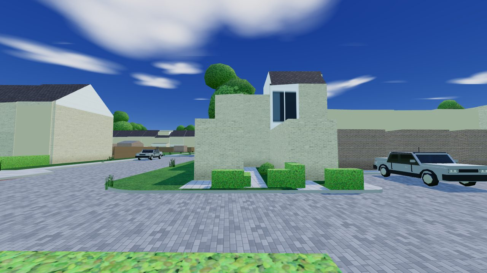 | [Street View](https://www.google.com/maps/@?api=1&map_action=pano&viewpoint=53.020161,5.645233&heading=95&pitch=5&fov=80) | De voorkant kijkt in het spel tegen een blinde kopgevel: waar zit de voordeur, en ligt de voorkant aan een andere kant? |
| Schoenlapper 307 | duinterpen_zalm | goot 7.67 m, nok 11.47 m, slanted | spel (1002.5, 275.5) RD 173218, 559085 53.018395, 5.658682 | 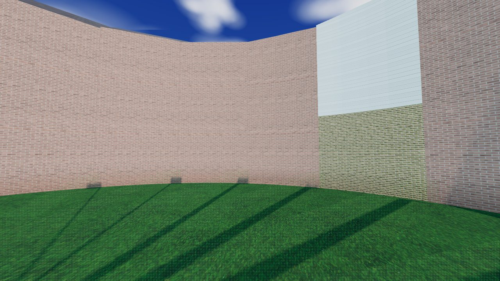 | [Street View](https://www.google.com/maps/@?api=1&map_action=pano&viewpoint=53.018315,5.658702&heading=351&pitch=5&fov=80) | Het gebogen blok in Duinterpen: aan welke kant zitten de voordeuren en ramen? |
| Kleine vos 18 | molenkrite | goot 8.57 m, nok 11.55 m, slanted | spel (987.0, 575.9) RD 173202, 558785 53.015696, 5.658434 | 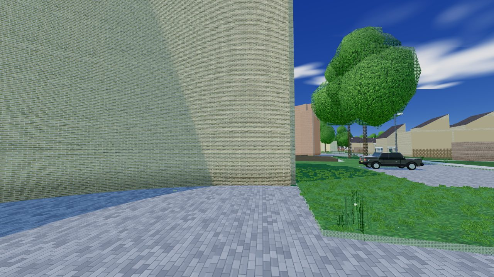 | [Street View](https://www.google.com/maps/@?api=1&map_action=pano&viewpoint=53.015702,5.658568&heading=265&pitch=5&fov=80) | Voorkant zonder openingen in het spel: welke gevel is de voorkant, en hoe ziet die eruit? |
| Kleine vos 24 | appart | goot 8.7 m, nok 11.45 m, multiple horizontal | spel (993.8, 585.6) RD 173209, 558775 53.015609, 5.658534 | 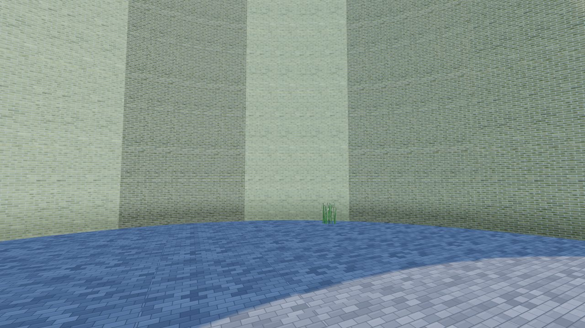 | [Street View](https://www.google.com/maps/@?api=1&map_action=pano&viewpoint=53.015683,5.658589&heading=204&pitch=5&fov=80) | Appartementen: waar is de entree, en hoeveel lagen? |
| Pikpôllewei 38T | jasker_flat | goot 2.37 m, nok 2.45 m, horizontal | spel (-1460.8, 670.0) RD 170754, 558691 53.014928, 5.621955 | 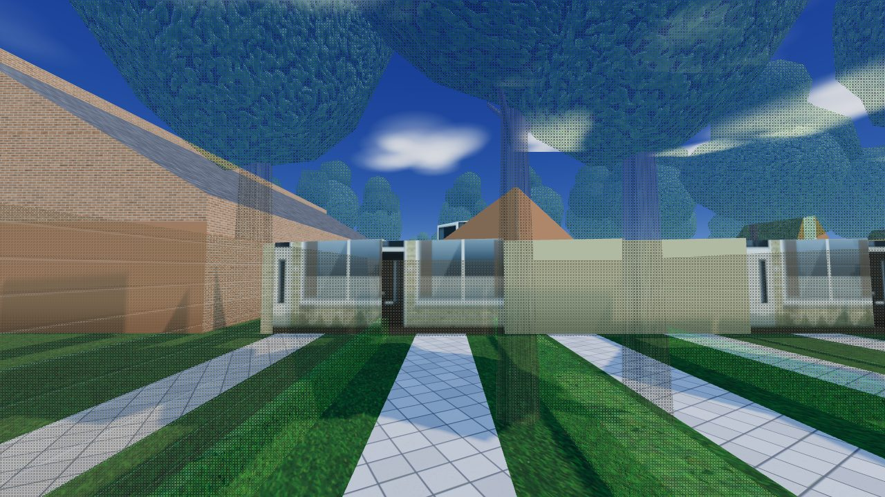 | [Street View](https://www.google.com/maps/@?api=1&map_action=pano&viewpoint=53.014857,5.621891&heading=28&pitch=5&fov=80) | Een rij met letters (38P–38Z): woningen of bergingen/garageboxen? |
| Geeuwkade 19C | molenkrite_bung | goot 1.8 m, nok 3.01 m, slanted | spel (-1374.6, 954.6) RD 170840, 558406 53.012368, 5.623225 | 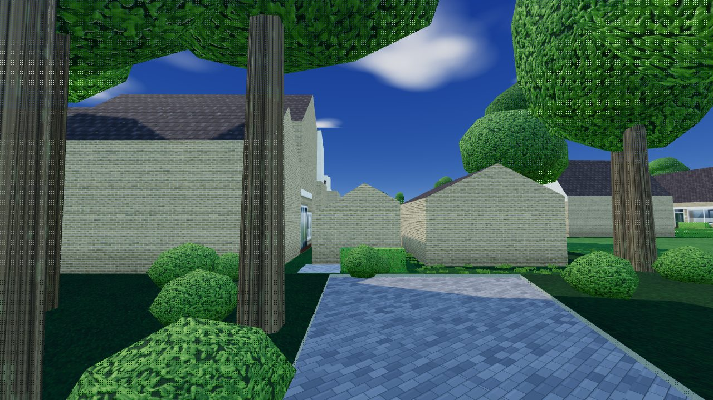 | [Street View](https://www.google.com/maps/@?api=1&map_action=pano&viewpoint=53.012434,5.623303&heading=215&pitch=5&fov=80) | 19B–19D: bungalows aan het water; waar is de voorkant? |
| Galamagracht 13 | molenkrite_kap | goot 3.26 m, nok 8.48 m, slanted | spel (-1368.0, 1185.2) RD 170847, 558176 53.010295, 5.623313 | 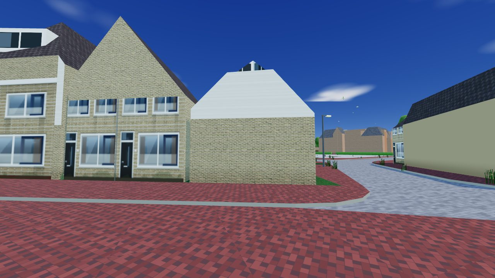 | [Street View](https://www.google.com/maps/@?api=1&map_action=pano&viewpoint=53.010219,5.623268&heading=19&pitch=5&fov=80) | Voorkant kaal in het spel: welke kant is de voorgevel? |
| Keizersmantel 367 | molenkrite | goot 8.05 m, nok 11.26 m, slanted | spel (1139.5, 304.6) RD 173354, 559056 53.018129, 5.660721 | 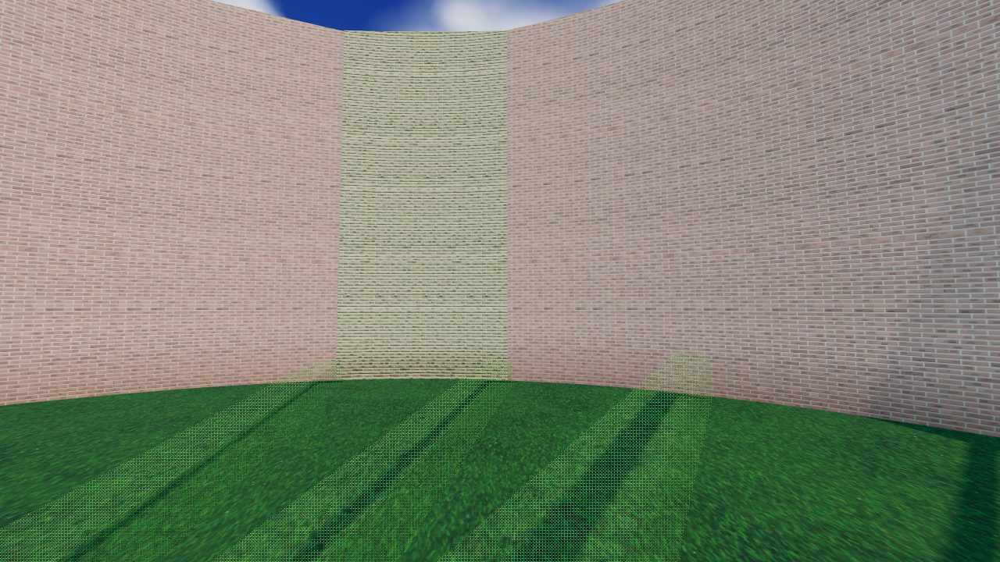 | [Street View](https://www.google.com/maps/@?api=1&map_action=pano&viewpoint=53.018048,5.660715&heading=2&pitch=5&fov=80) | Naast de Poiesz: winkel of woning, en hoe ziet de gevel aan de straat eruit? |
| Zilverschoon 72 | molenkrite_kap | goot 2.75 m, nok 9.92 m, slanted | spel (1034.4, 58.3) RD 173249, 559303 53.020346, 5.659169 | 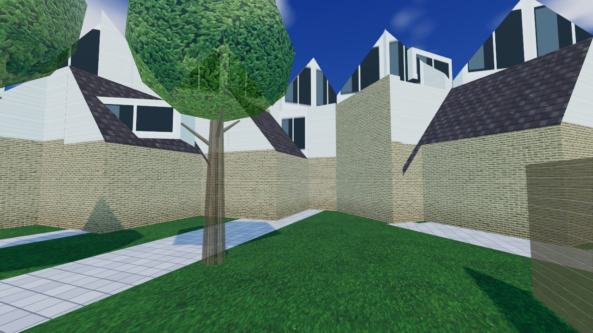 | [Street View](https://www.google.com/maps/@?api=1&map_action=pano&viewpoint=53.020270,5.659212&heading=341&pitch=5&fov=80) | 72–80: voorkant kaal in het spel; deur en ramen aan welke kant? |
| Parelmoervlinder 6 | molenkrite | goot 8.09 m, nok 10.71 m, slanted | spel (1262.4, 381.5) RD 173477, 558979 53.017434, 5.662548 | 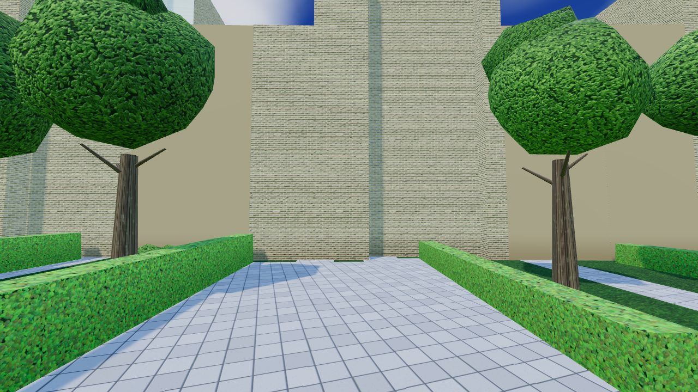 | [Street View](https://www.google.com/maps/@?api=1&map_action=pano&viewpoint=53.017409,5.662675&heading=288&pitch=5&fov=80) | Voorkant kaal in het spel; ook de buurt van Mark (Parelmoervlinder 3, missie 13). |
| Omloop 53 | jasker_flat | goot 5.9 m, nok 6.08 m, multiple horizontal | spel (205.6, 92.1) RD 172421, 559269 53.020070, 5.646816 | 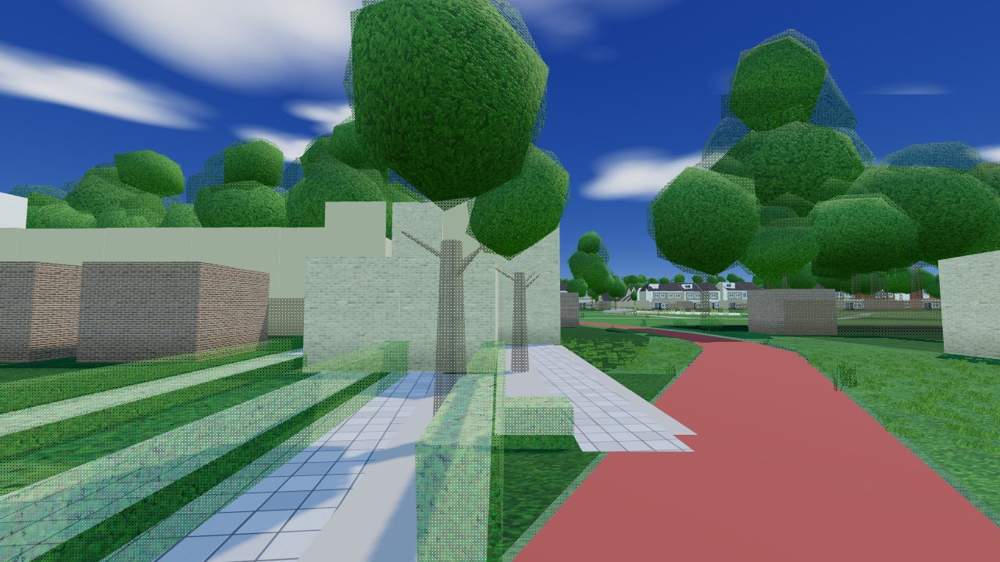 | [Street View](https://www.google.com/maps/@?api=1&map_action=pano&viewpoint=53.020078,5.646682&heading=95&pitch=5&fov=80) | Straat zonder foto: steenkleur, kozijnen, dak, voortuin. |
| Zeskanter 2 | eekmolen | goot 3.06 m, nok 3.14 m, horizontal | spel (378.9, 364.5) RD 172594, 558996 53.017616, 5.649383 | 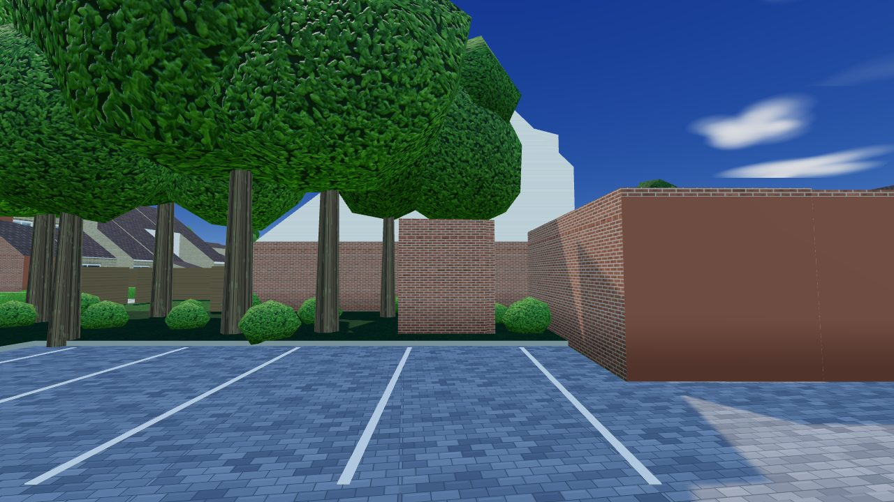 | [Street View](https://www.google.com/maps/@?api=1&map_action=pano&viewpoint=53.017696,5.649400&heading=187&pitch=5&fov=80) | Straat zonder foto (Zeskanter 16 is een te kopen woning): steenkleur, kozijnen, dak. |
| Buitenroede 40 | tinga_blauw | goot 5.73 m, nok 8.98 m, slanted | spel (195.5, -172.0) RD 172410, 559533 53.022443, 5.646679 | 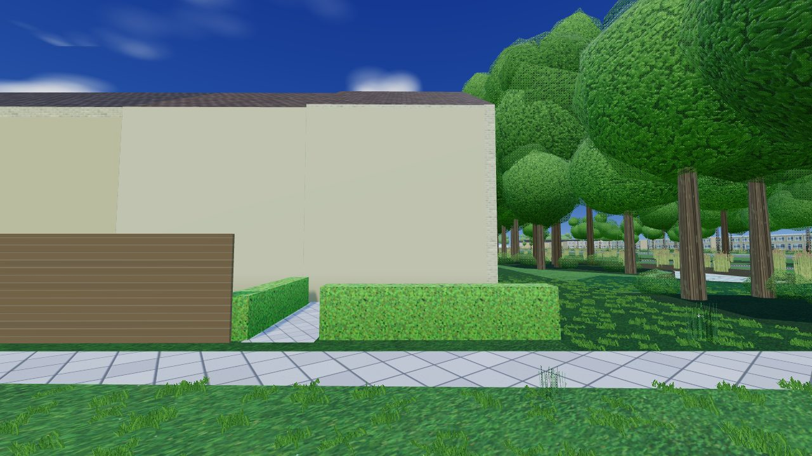 | [Street View](https://www.google.com/maps/@?api=1&map_action=pano&viewpoint=53.022395,5.646788&heading=306&pitch=5&fov=80) | Buitenroede 40–74 zonder foto: de blauwe rij; klopt de kleur en de indeling? |
| Kruirad 46 | kruirad | goot 5.75 m, nok 8.88 m, slanted | spel (-77.8, -6.3) RD 172137, 559367 53.020963, 5.642598 | 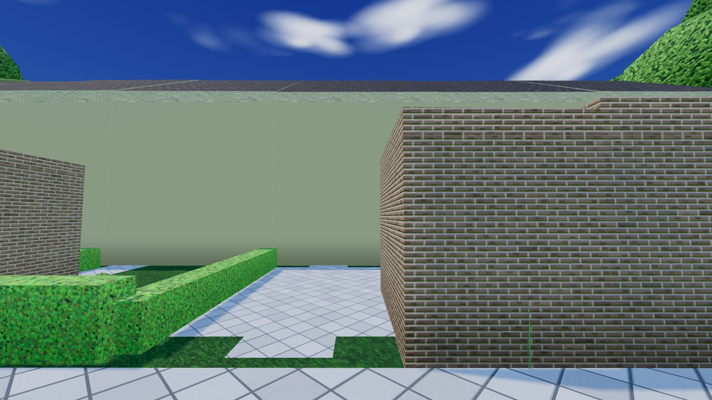 | [Street View](https://www.google.com/maps/@?api=1&map_action=pano&viewpoint=53.021018,5.642696&heading=227&pitch=5&fov=80) | De achterkant van het Kruirad (open punt 5): graag ook een foto van de achterkant. |
| Galamagracht 31-34 | spil | goot 3.87 m, nok 8.09 m, slanted | spel (-1325.5, 1275.2) RD 170890, 558086 53.009486, 5.623942 | 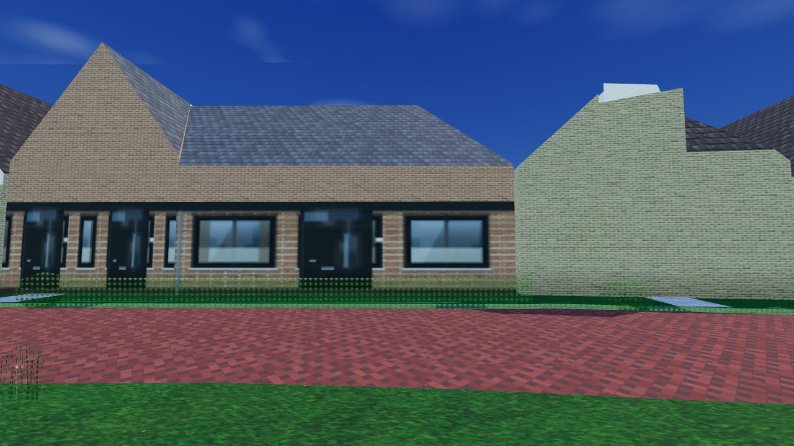 | [Street View](https://www.google.com/maps/@?api=1&map_action=pano&viewpoint=53.009479,5.623808&heading=85&pitch=5&fov=80) | Nog het naamloze type spil (open punt 11): wat voor gebouw is dit? |
